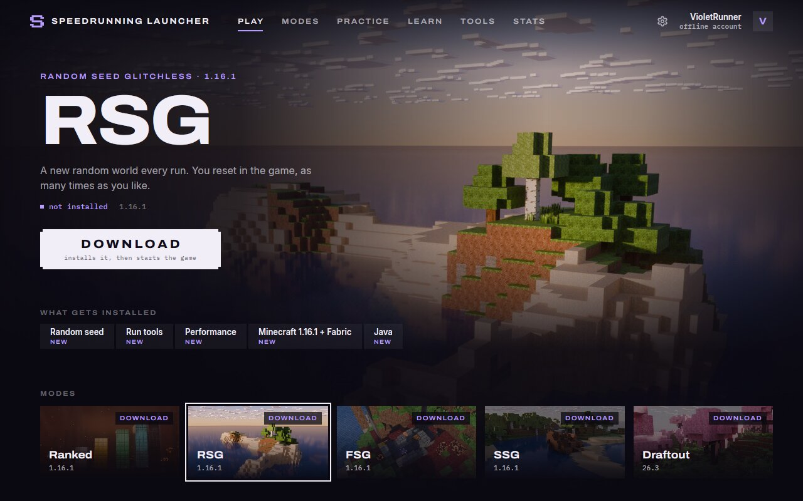
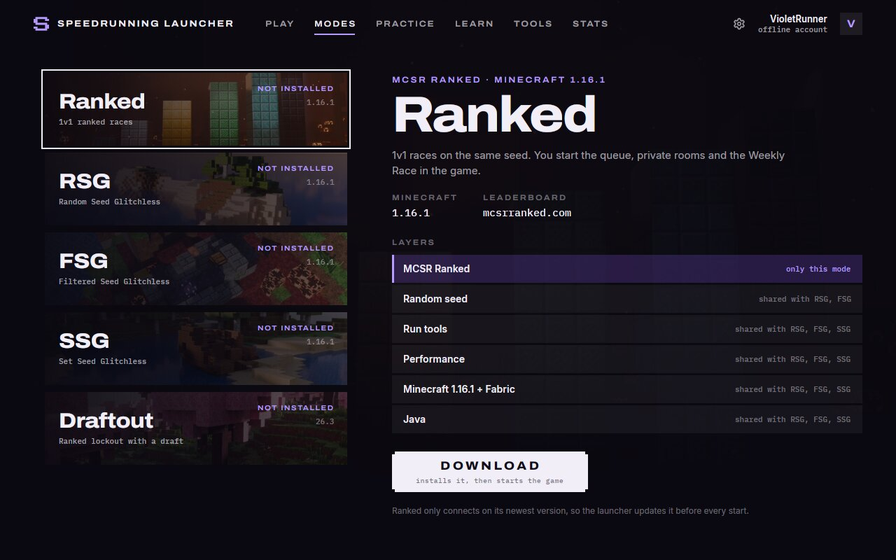
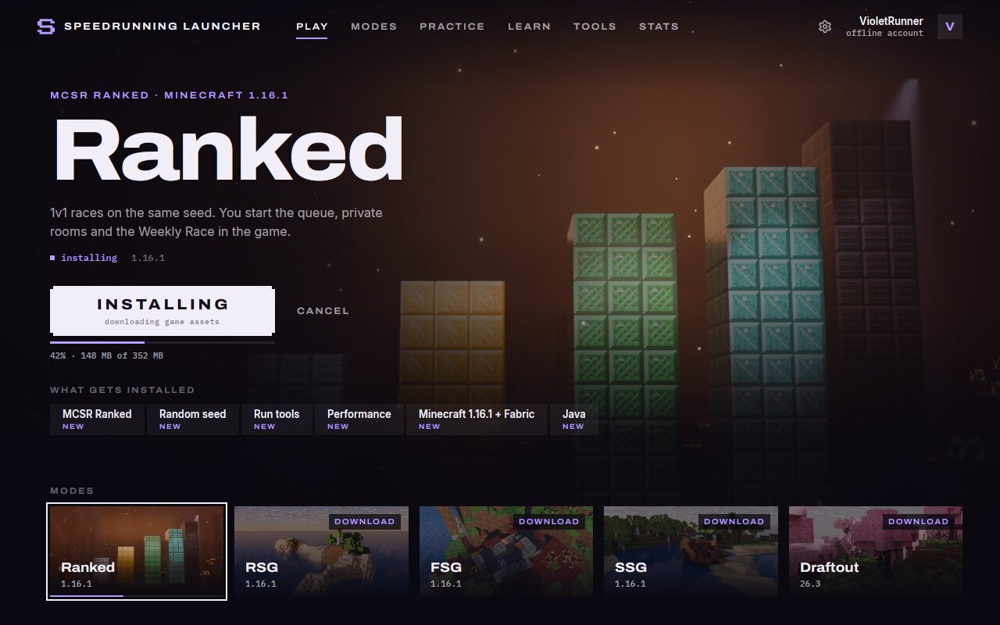
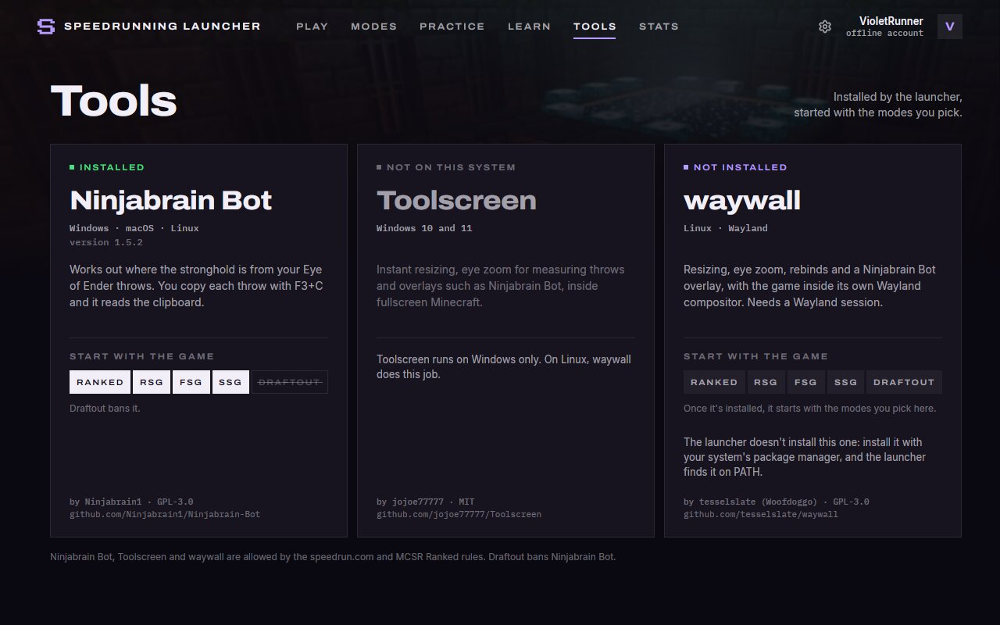
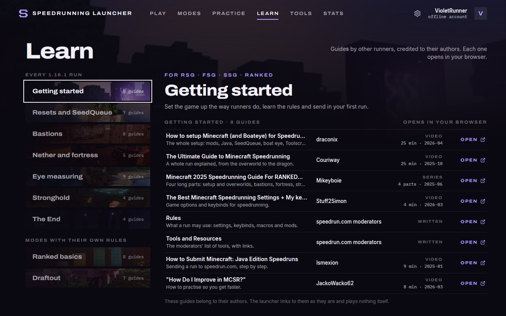

<p align="center">
  
</p>

<h1 align="center">Speedrunning Launcher</h1>

<p align="center">
  A fast Minecraft launcher made for speedrunning.<br>
  Pick a mode and press Play. Java, Minecraft, Fabric and the legal mod set are set up for you.
</p>

<p align="center">
  <a href="https://github.com/mlodygbelmondo/speedrunning-launcher/actions/workflows/launcher.yml"></a>
</p>



> [!NOTE]
> **Early development.** Milestones 1 and 2 work, and most of milestone 3: the launcher installs and starts all five
> modes with an offline account, starts Ninjabrain Bot, Toolscreen (Windows) or waywall (Linux) with the game, shows
> your stats and installs practice maps. Microsoft login is built but off until Mojang approves our client ID. It is
> **not yet on
> speedrun.com's list of allowed launchers** (rule A.1.1), so don't submit runs made with it yet.

## Why another launcher

- **One click to a ready run.** No instance setup, no hunting for mods, no wrong Java version.
- **Legal mods only.** Mod sets come from [mcsr-meta](https://github.com/tildejustin/mcsr-meta), the same source as
  [mc.sr/mods](https://mc.sr/mods/). Before the game starts, every jar is checked by SHA-512: legal-board mods
  against the community's `legal-builds.csv`, and the Ranked, FSG and Draftout mods against their published hashes.
  Jars that don't belong to the set are taken out; ones you added yourself go to `mods-removed/`, never deleted.
- **One instance, your mods.** Ranked, RSG, FSG and SSG share one Minecraft 1.16.1 instance: the same options,
  keys, worlds and resource packs. Each mode is a set of mods (and its own Atum settings), and on the Mods page you
  turn mods on and off like in MultiMC, or add your own jars. A set that isn't legal for the mode is flagged; the
  game still starts.
- **Tools with the game.** Ninjabrain Bot and, on Windows, Toolscreen are installed at legal versions, checked by
  hash, start with the game and close when it exits. You choose per mode which ones start; Draftout, which bans
  Ninjabrain Bot, never gets it. On Linux the launcher can run the game inside your own waywall.
- **Fast.** Native Rust and GPUI, chosen after measuring Tauri, Electron and GPUI on real hardware
  ([results](bakeoff/results/)). Pressing Play again starts the game in about 0.1 s.
- **Honest.** The launcher prepares and starts the game. Queues, private rooms and resets stay in Minecraft, where
  the mods put them, and the UI never shows numbers it doesn't have.

## Modes

| Mode | Minecraft | Java | On top of the standard legal 1.16.1 set |
|---|---|---|---|
| **MCSR Ranked** | 1.16.1 | 21 | the MCSR Ranked mod |
| **RSG** | 1.16.1 | 21 | nothing: SeedQueue, Atum, WorldPreview, SpeedRunIGT, Sodium and the rest of the standard set |
| **FSG** | 1.16.1 | 21 | the FSG mod |
| **SSG** | 1.16.1 | 21 | SetSpawn, without WorldPreview and LazyStronghold |
| **Draftout** | 26.3 | 25 | its own 26.3 set and the Draftout mod |

Modes share everything they can. Libraries, assets and Java runtimes are stored once, and mod jars sit in one
content-addressed store.

<table>
  <tr>
    <td></td>
    <td></td>
  </tr>
</table>

## Tools and guides

| Tool | Runs on | What the launcher does |
|---|---|---|
| [Ninjabrain Bot](https://github.com/Ninjabrain1/Ninjabrain-Bot) | Windows, macOS, Linux | Installs 1.5.2 (the newest version the rules allow), starts it next to the game, closes it when the game exits. Banned in Draftout. |
| [Toolscreen](https://github.com/jojoe77777/Toolscreen) | Windows 10 and 11 | Installs a release whose DLLs are on the legal list and loads it into the game. Not set up for Draftout yet. |
| [waywall](https://github.com/tesselslate/waywall) | Linux, in a Wayland session | Finds the one your package manager installed and runs the game inside it, in the modes you turn it on for. |

The Learn page links other runners' guides by topic, from the first setup to Ranked and Draftout, each credited to
its author and opened in your browser.

<table>
  <tr>
    <td></td>
    <td></td>
  </tr>
</table>

## Download

Download `speedrunning-launcher-setup.exe` from the
[latest release](https://github.com/mlodygbelmondo/speedrunning-launcher/releases/latest) and run it. It installs
the launcher for your Windows user, without admin rights, in `%LOCALAPPDATA%\Programs\Speedrunning Launcher`, with
a Start menu entry; uninstall it from Settings → Apps (your data stays). If you'd rather not install anything,
`speedrunning-launcher-windows.zip` is the same launcher: unzip it anywhere you can write to (not `Program Files`)
and run `speedrunning-launcher.exe`.

From then on the launcher updates itself: on start it looks for a newer release, downloads it in the background,
checks it against the release's SHA-256 and installs it for the next start (Settings, About: "Restart to update",
"Check now", and a switch to turn the automatic check off). Until the builds are signed (see the
[Code signing policy](#code-signing-policy)), SmartScreen may ask: choose *More info*, then *Run anyway*. The release
notes say whether a build is signed.

Test builds of every change on the `launcher` branch are the
[`launcher-latest`](https://github.com/mlodygbelmondo/speedrunning-launcher/releases/tag/launcher-latest)
prerelease. They update themselves to the next numbered release once it is newer than their version.

The launcher keeps its data in `%LOCALAPPDATA%\SpeedrunningLauncher\data` on Windows and in
`~/.local/share/speedrunninglauncher` on Linux. Versions up to 0.2.3 kept it in `%APPDATA%` (Roaming) on Windows; a
newer launcher moves it on its first start.

## Build from source

The app is the Rust workspace in [`launcher/`](launcher/).

```sh
# Linux: the libraries GPUI builds against
sudo apt install build-essential pkg-config libxkbcommon-dev libxkbcommon-x11-dev libxcb1-dev \
  libwayland-dev libfontconfig-dev libfreetype-dev libvulkan1

cd launcher
cargo build --release -p srl-app
./target/release/speedrunning-launcher                 # the app
./target/release/speedrunning-launcher --install rsg   # headless install, for CI and support
./target/release/speedrunning-launcher --status        # what is installed
./target/release/speedrunning-launcher --tools         # the state of each tool
```

On Windows, build with the MSVC toolchain. Release builds also need the Windows SDK.

## Roadmap

- [x] **Milestone 1:** pick a mode, press Play, and the game starts with the right mods. Tested end to end on Linux;
  Windows builds pass CI, and a test on a real Windows desktop is next.
- [x] **Milestone 2:** Ninjabrain Bot, Toolscreen (Windows) and waywall (Linux) start with the game and stop with
  it. New pages: Tools (install, update, which modes start each tool), Learn (guides by topic), Stats (what it will
  show) and the full Settings (memory per mode, optional mods, credits). Tested end to end on Linux; Toolscreen inside
  a real game still needs a test on a Windows desktop.
- [ ] **Milestone 3:** works, except Microsoft login, which waits for Mojang.
  - Stats: PB, sum of best and recent runs with splits from your SpeedRunIGT records, your MCSR Ranked elo,
    matches and Weekly Race, and your Draftout elo. API data is cached, so it still shows offline.
  - Practice: maps installed from their authors' releases (checked by hash), then reset, updated or removed, and
    played in a separate practice instance with Ninjabrain Bot.
  - Microsoft login is built and tested against a mock of the Microsoft, Xbox and Minecraft services: log in, switch
    accounts, and play every mode with the account. It stays off until Mojang approves our client ID; until then
    every mode plays with an offline account.
  - Tested end to end on Linux.
- [ ] Approval as an allowed launcher on speedrun.com.
- [ ] Auto-update: built (numbered releases from version tags, and the launcher updates itself from them); waits
  for the first release and a test on Windows.
- [ ] Installer and code signing: the installer is built (per user, no admin rights); signing waits for SignPath.

Day-to-day progress is in [`WORKLOG.md`](WORKLOG.md) (in Polish).

## Repository

| Path | What's there |
|---|---|
| [`launcher/`](launcher/) | The app. Crates: `srl-core` (shared types, verified downloads), `srl-game` (Minecraft, Java, Fabric, starting the game), `srl-mods` (legal mod sets), `srl-tools` (Ninjabrain Bot, Toolscreen, waywall), `srl-stats` (SpeedRunIGT records, MCSR Ranked and Draftout), `srl-practice` (practice maps), `srl-auth` (Microsoft login), `srl-app` (the GPUI app). |
| [`bakeoff/`](bakeoff/) | The Tauri, Electron and GPUI performance bake-off, and the prototype the app's design comes from. |
| [`research/`](research/) | Research reports: tech stack, the MCSR ecosystem, launcher internals, practice maps, visual directions. |
| [`design-proposals/`](design-proposals/) | Redesign mockups and the Blender sources of the key art. |

## Credits

- [Pandora Launcher](https://github.com/Moulberry/PandoraLauncher) (MIT): parts of the game install and launch
  code, listed in [`launcher/THIRD_PARTY_NOTICES.md`](launcher/THIRD_PARTY_NOTICES.md).
- [EasyInjectBundled](https://github.com/jojoe77777/EasyInjectBundled) (MIT): how Toolscreen is loaded into the game.
- The tools belong to their authors: Ninjabrain Bot (Ninjabrain1, GPL-3.0), Toolscreen (jojoe77777, MIT) and
  waywall (tesselslate, GPL-3.0). The launcher downloads Ninjabrain Bot and Toolscreen from their releases and ships
  none of them.
- The guides on the Learn page belong to their authors, named next to each one.
- [mcsr-meta](https://github.com/tildejustin/mcsr-meta) and the
  [legal-mods](https://github.com/Minecraft-Java-Edition-Speedrunning/legal-mods) repository: the mod lists.
- Key art: our own Blender renders with our own textures; no Minecraft files are used
  ([`launcher/assets/art/CREDITS.md`](launcher/assets/art/CREDITS.md); the launcher shows
  [`launcher/assets/credits.md`](launcher/assets/credits.md) in Settings).
- Fonts: Archivo, IBM Plex Mono and Inter, all under the SIL Open Font License 1.1.

## Code signing policy

Free code signing provided by [SignPath.io](https://about.signpath.io), certificate by
[SignPath Foundation](https://signpath.org).

- **Committers and reviewers:** [mlodygbelmondo](https://github.com/mlodygbelmondo)
- **Approvers:** [mlodygbelmondo](https://github.com/mlodygbelmondo)

Only `speedrunning-launcher.exe` and its installer `speedrunning-launcher-setup.exe`, built by GitHub Actions from
this repository ([`.github/workflows/launcher.yml`](.github/workflows/launcher.yml)), are signed, and an approver
confirms every signing request. The tools, mods and practice maps the launcher downloads belong to their authors and are not
signed by this project. How a build gets signed: [`launcher/tools/windows/SIGNPATH.md`](launcher/tools/windows/SIGNPATH.md).

### Privacy

The launcher has no telemetry and sends no data about you to this project. It connects only to the services a
feature needs:

- **Installing and updating the game:** Mojang (game files and the Java runtime), Fabric (the mod loader),
  mcsr-meta and Modrinth (the mod lists and mods), and GitHub (the legal mod lists, tools and practice maps). On
  start the launcher downloads the current mod lists to see whether installed modes need updates.
- **Signing in with Microsoft**, when you choose to: Microsoft, Xbox Live and Minecraft services. The sign-in
  token stays on your computer.
- **Updating the launcher**, on start (unless turned off in Settings) and when you click "Check now": GitHub's
  API for the latest release of this repository, then GitHub for its download.
- **Stats**, when you open them: the public MCSR Ranked and Draftout APIs, asked for the nickname you play with.
- **Skins** on the Stats and account screens: Minecraft's texture server.

The game itself and the tools you install follow their own privacy rules.

## Licence

Speedrunning Launcher is free software under the [GNU General Public License v3.0 or later](LICENSE). Code we
reused from other projects keeps its own licence; see [`launcher/THIRD_PARTY_NOTICES.md`](launcher/THIRD_PARTY_NOTICES.md).

---

<sub>NOT AN OFFICIAL MINECRAFT PRODUCT. NOT APPROVED BY OR ASSOCIATED WITH MOJANG OR MICROSOFT.</sub>
