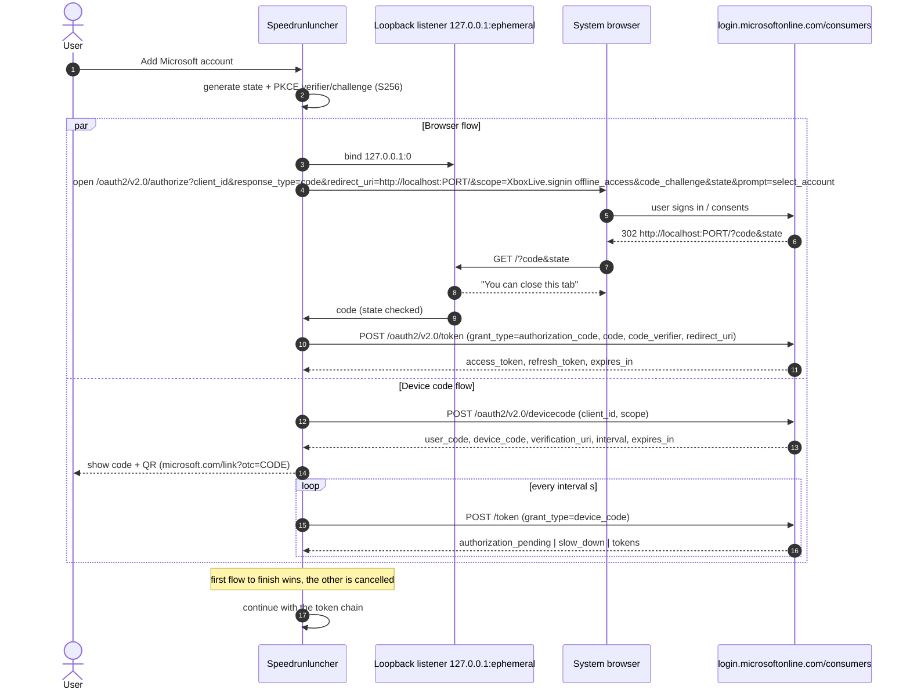
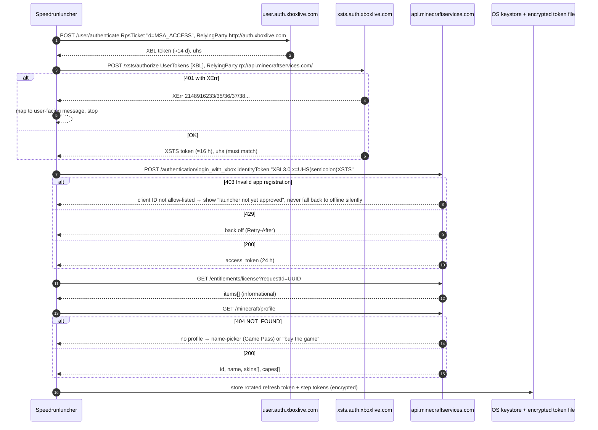
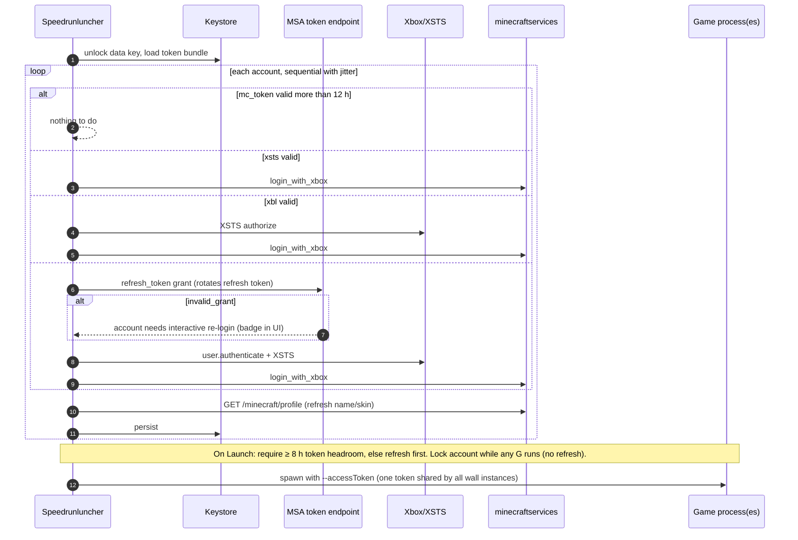

# 03: Authentication and launcher core

Research date: 2026-10-23. I checked sources directly against live endpoints, upstream source code and official docs:
- Prism Launcher `develop` at `b31a6e17` (2026-10-23)
- MultiMC/Launcher at `2a684511`
- Modrinth `modrinth/code` at `9c31607`
- Pandora Launcher at `2d83d6f`
- MCSR Launcher
- the MCSR Ranked 6.0.4 jar, read as bytecode with `javap`
- the speedrun rules repo at `6cff8ae`

Markers:
- **[unverified]**: I could not confirm the claim from a primary source.
- **[inferred]**: my own reasoning, not something a source states.
- **[anecdotal]**: reports from developers, not official statements.

---

## 0. TL;DR

1. **Auth:** do what Prism does today, not what MultiMC does.
   - MultiMC uses device code only. Prism runs two flows at once:
     - the **system browser with auth code + PKCE and a loopback redirect**;
     - the **device code flow**, shown in the same dialog with a QR code.
   - Whichever flow finishes first wins.
   - Improve on Prism in three ways:
     - keep tokens in the OS keystore (Prism writes them in plaintext to `accounts.json`);
     - cache each step of the token chain;
     - refresh silently before launch, so a speedrun session never starts with a token that expires soon.
2. **Blocker on the critical path:** our own Entra app (client ID) must be **allow-listed by Mojang** before it can call `api.minecraftservices.com`.
   - Form: <https://aka.ms/mce-reviewappid>. Policy page: <https://aka.ms/AppRegInfo>.
   - Mojang reviews submissions weekly. Turnaround is weeks, sometimes no reply, and rejections come with no reason.
   - Reusing Prism's or MultiMC's client ID is not allowed.
   - **Start this in week 1.**
3. **Second gate:** **speedrun.com rule A.1.1 lists the allowed launchers.** We have to ask for legalisation, or runs done in our launcher are invalid. Two launchers are already on the list:
   - **MCSR Launcher** (Kotlin, GPL-3.0, made by the MCSR Ranked developer);
   - **Pandora Launcher** (Rust, MIT, with reflink/hardlink deduplication, keyring storage and loopback PKCE). It is the closest prior art and MIT code we can reuse.
4. **Content store:**
   - Libraries, assets and Java runtimes are already content-addressed (Maven paths and Mojang sha1). Share them by *path*, with no linking.
   - Only per-instance `mods/` and resource packs need materialising. Use a sha512-keyed store and materialise with **reflink → hardlink → copy**. Never use symlinks on Windows.
   - The MCSR Ranked anti-cheat hashes the *contents* of mod jars (SHA-512 against `mcsr-meta`). It does not check for links.
5. **Licence:** **MIT OR Apache-2.0**. Build on permissively licensed Rust code (Pandora's auth and launch crates, lighty-launcher, the `oauth2` crate, `keyring`/`oo7`). Read Prism and theseus (both GPL-3.0-only) for behaviour only.
   - Choose GPL-3.0 only if we decide to fork theseus or MCSR Launcher wholesale.

---

## 1. Microsoft account authentication

### 1.1 Prism today (step by step)

Code: `launcher/minecraft/auth/` and `launcher/minecraft/auth/steps/` in <https://github.com/PrismLauncher/PrismLauncher/tree/develop/launcher/minecraft/auth>.

Step order is set in the `AuthFlow.cpp` constructor:

| # | Step (file) | Request | Notes |
|---|---|---|---|
| 1a | `MSAStep` (browser) | `GET https://login.microsoftonline.com/consumers/oauth2/v2.0/authorize`, then `POST …/consumers/oauth2/v2.0/token` | Qt `QOAuth2AuthorizationCodeFlow`. Scope `XboxLive.SignIn XboxLive.offline_access`, `prompt=select_account`. Uses **PKCE S256 implicitly**: Prism needs Qt ≥ 6.8, where S256 is the default. |
| | redirect, mode A | loopback `http://127.0.0.1:<random port>/` (`QOAuthHttpServerReplyHandler`, port 0) | Used for AppImage, portable installs, or when the URL scheme isn't registered. The page then redirects to `https://prismlauncher.org/successful-login`. |
| | redirect, mode B | custom scheme `prismlauncher://oauth/microsoft` | The OS hands the URL to the running app (PR #2504). |
| 1b | `MSADeviceCodeStep` | `POST …/consumers/oauth2/v2.0/devicecode`, then poll `…/token` with `grant_type=urn:ietf:params:oauth:grant-type:device_code` | RFC 8628: `slow_down` adds 5 s; `authorization_pending` keeps polling. **Runs alongside 1a** in `MSALoginDialog` (L99–118), which shows the code, a link (`https://www.microsoft.com/link?otc=<code>`) and a QR code. |
| 2 | `XboxUserStep` | `POST https://user.auth.xboxlive.com/user/authenticate` | Body `{"Properties":{"AuthMethod":"RPS","SiteName":"user.auth.xboxlive.com","RpsTicket":"d=<msa_access_token>"},"RelyingParty":"http://auth.xboxlive.com","TokenType":"JWT"}`. Header `x-xbl-contract-version: 1`. Stores `Token`, `NotAfter` and `DisplayClaims.xui[0].uhs`. |
| 3 | `XboxAuthorizationStep` | `POST https://xsts.auth.xboxlive.com/xsts/authorize` | Body `{"Properties":{"SandboxId":"RETAIL","UserTokens":["<xbl token>"]},"RelyingParty":"rp://api.minecraftservices.com/","TokenType":"JWT"}`. Checks that the `uhs` matches step 2. The second XSTS call (to `http://xboxlive.com`, used for the gamertag) was **removed** in PR #4958 (Feb 2026). |
| 4 | `LauncherLoginStep` | `POST https://api.minecraftservices.com/launcher/login` | Body `{"xtoken":"XBL3.0 x=<uhs>;<xsts>","platform":"PC_LAUNCHER"}`. Returns `access_token` and `expires_in` (86400). minecraft.wiki, Pandora and MCSR Launcher use `POST /authentication/login_with_xbox` with `{"identityToken":"XBL3.0 x=<uhs>;<xsts>"}` instead. Both work today. |
| 5 | `EntitlementsStep` | `GET https://api.minecraftservices.com/entitlements/license?requestId=<uuid>` | `game_minecraft` sets canPlay; `product_minecraft` sets owns. The JWT signature is **not** verified (there's a TODO), and errors are ignored. |
| 6 | `MinecraftProfileStep` | `GET https://api.minecraftservices.com/minecraft/profile` | A 404 `NOT_FOUND` counts as a valid "account has no profile" state; the user must pick a name first. Skin and cape URLs are rewritten to https. |
| 7 | `GetSkinStep` | GET the skin PNG | Failures are ignored. Changing skins and capes lives in `minecraft/skins/SkinRequests.cpp` (`POST /minecraft/profile/skins`, `PUT|DELETE /minecraft/profile/capes/active`). |

**How Prism refreshes** (`MinecraftAccount::shouldRefresh`, `AccountList.cpp`):
- It re-runs the **whole chain**, starting from the MSA refresh token. It ignores the Xbox and XSTS expiry times.
- It refreshes when the Minecraft token has less than 12 h left.
- It never refreshes an account while a running game is using it.
- It refreshes one account at a time, waits 20 s between accounts, and checks again every hour.
- HTTP 429 is retried using `Retry-After` or a 10·2ⁿ s backoff.
- If the stored client ID differs from the build's ID, the account is disabled and the user must log in again.
- On a hard failure it wipes the refresh token. On a network error, or on 403 (which `NetUtils.h` treats as a "server error"), the account goes to `STATE_OFFLINE`.

**Client ID:**
- Prism's ID is compiled in: `Launcher_MSA_CLIENT_ID` in `CMakeLists.txt` L268. Users can override it at runtime with `MSAClientIDOverride`.
- Prism's README (L94–110) asks forks with code changes to set their own key or leave it empty.
- MultiMC's README is stricter: "You will also have to register your own app on Azure."
- Microsoft's Identity Platform Terms of Use, §3.2: credentials are "non-transferable … You may not share your Access Credentials with anyone else" (<https://learn.microsoft.com/en-us/legal/microsoft-identity-platform/terms-of-use>).
- **So we cannot reuse another launcher's ID.** Mojang's form also has a path for *reporting* an existing app ID.

**MultiMC today** (<https://github.com/MultiMC/Launcher>):
- **Device code only**, through the bundled `katabasis` library.
- No webview and no loopback redirect.
- It still makes two XSTS calls and a gamertag call.

### 1.2 Token lifetimes

| Token | Lifetime | Source |
|---|---|---|
| MSA access token | 60–90 min, randomised (`expires_in` ≈ 3599 in examples) | <https://learn.microsoft.com/en-us/entra/identity-platform/access-tokens> |
| MSA refresh token | 90 days. It **rotates on every use**, so always store the new one. That makes it a sliding window. A password change can revoke it early. | <https://learn.microsoft.com/en-us/entra/identity-platform/refresh-tokens> |
| Xbox user token | about 14 days, inferred from example `IssueInstant`/`NotAfter` **[not officially documented]** | <https://minecraft.wiki/w/Microsoft_authentication> |
| XSTS token | about 16 h, same caveat **[not officially documented]** | same |
| Minecraft access token | 24 h (`expires_in: 86400`) | same; Prism `MinecraftAccount.cpp` L214 |
| Auth code (browser flow) | about 1 min | <https://learn.microsoft.com/en-us/entra/identity-platform/v2-oauth2-auth-code-flow> |
| Device code | 15 min by default (`expires_in`) | <https://learn.microsoft.com/en-us/entra/identity-platform/v2-oauth2-device-code> |

### 1.3 Error codes to handle

XSTS `XErr` values. These arrive on HTTP 401 from `xsts/authorize`; Prism's handling is in `XboxAuthorizationStep::processSTSError`.

| XErr | Meaning | What to show the user |
|---|---|---|
| 2148916233 | No Xbox profile. The account has never used Xbox/Minecraft services. | Sign in once at minecraft.net or xbox.com to create a profile, or buy the game. |
| 2148916235 | Xbox Live is not available in this country or region | Region blocked. A VPN does not help: the block follows the account's region. |
| 2148916236 / 2148916237 | Adult verification required (South Korea) per minecraft.wiki. Prism shows "proof of age" for 236 and "playtime limit reached" for 237, so the sources disagree. | Link to login.live.com to verify. |
| 2148916238 | Child account (under 18) that isn't in a Microsoft Family group | An adult must add the account to a family (<https://help.minecraft.net/hc/en-us/articles/4408968616077>). |
| 2148916227 | Banned from Xbox (Community Standards violation) | — |
| 2148916229 | A guardian has not allowed online play | account.microsoft.com/family |
| 2148916234 | Xbox terms of service not accepted | Sign in at xbox.com |
| 2148916262 | Unknown (listed on minecraft.wiki) | Generic error message |

Minecraft services errors:

| Status | Meaning |
|---|---|
| **403** `"Invalid app registration, see https://aka.ms/AppRegInfo"` | The client ID is **not allow-listed**. Prism does not recognise this case and silently degrades to "offline". We should detect it and show a clear message. |
| 404 `NOT_FOUND` on `/minecraft/profile` | No profile. Either the account doesn't own the game, or it's a Game Pass account that hasn't picked a name yet. |
| 429 | Rate limited. Back off and honour `Retry-After`. |
| 401 | The Minecraft token has expired. Refresh from the stored XSTS token, or from MSA if needed. |

Errors from Microsoft's identity platform:
- `invalid_grant` on refresh: the refresh token was revoked or has expired. The user must log in interactively again.
- `AADSTS70002` during device code: "Allow public client flows" is not enabled on the app registration.
- `authorization_declined` and `expired_token` during device code: the user declined, or the code expired.

### 1.4 The Mojang approval requirement (the blocker)

**Policy page:**
- <https://aka.ms/AppRegInfo> redirects to <https://help.minecraft.net/hc/en-us/articles/16254801392141>, titled "Java Edition Game Service API Review or Application Process". It has existed since at least June 2023.
- The article says: *"we will be reviewing and manually adding all future API integration requests to an allow list. Existing applications … will continue to have access without interruption. However, new applications must request access via this form."*
- Contact: `enforce@minecraft.net`.

**Form:** <https://aka.ms/mce-reviewappid>, which redirects to a Microsoft Forms page titled "AppID Review". I read it on 2026-10-23.
- The intro text states three conditions:
  - *"Applications must verify the user's game ownership and require authentication before enabling gameplay or access to servers or sites. Applications that bypass or disable authentication, ownership or license checks, or other safety features will not be approved."*
  - The app name must not contain Mojang, Minecraft, Microsoft, Live, Xbox, Discord or Hypixel.
  - *"Submissions are reviewed weekly. Sending multiple submissions will not speed up the process."*
- The questions:
  1. Confirm that you have read the EULA and the Usage Guidelines (<http://aka.ms/mcusageguidelines>).
  2. Contact email. It is cross-checked against the Azure portal, so use the same address everywhere.
  3. Request type: *New AppID for Approval*.
  4. Application name.
  5. Application (client) ID. One per submission.
  6. Directory (tenant) ID. Required for new apps.
  7. Website or domain.
  8. Justification. Submissions without a valid one are not reviewed.
  9. Other information.

**How long it takes [anecdotal]:**
- DevLogin: about 5 weeks in 2023 (<https://github.com/PlanetTeamSpeakk/DevLogin/issues/10>).
- Voyager: some developers waited months with no answer in 2023–2025 (<https://github.com/MineDojo/Voyager/issues/119>).
- UN_Nexo: rejected in the 2026-09-21 batch with no reason given. They removed every offline-launch feature and resubmitted (<https://github.com/yannickfan67-ai/UN_Nexo/issues/22>).
- **Plan for 2–8 weeks, and plan for possibly having to resubmit.**

**Step list: Entra app registration**

1. **Get an Entra tenant.** The official quickstart now requires an Azure account and a tenant ("Default Directory"). Microsoft Q&A threads from 2025 report that creating an app registration "outside of a directory is deprecated" for bare personal accounts.
   - Fix: sign up at <https://azure.microsoft.com/free> with the project's Microsoft account. That creates a Default Directory, which costs nothing for app registrations.
   - Sources: <https://learn.microsoft.com/en-us/entra/identity-platform/quickstart-register-app> and <https://learn.microsoft.com/en-us/answers/questions/2154777/>. I found no dated official announcement of this change **[unverified]**.
   - Use a project-owned account, not a personal one, so the registration can be handed over later.
2. Go to **Entra admin center → App registrations → New registration**.
   - Name: "Speedrunluncher". No forbidden words.
   - **Supported account types: "Personal Microsoft accounts only"**, which means the `consumers` audience. minecraft.wiki says `XboxLive.signin` only works on the `consumers` authority. "Any Entra ID tenant + personal accounts" also works if we always call `/consumers/`.
3. **Add a redirect URI.** Platform: **"Mobile and desktop applications"**. Enter `http://localhost`.
   - Microsoft ignores the port on localhost redirects, so any port works at runtime.
   - Microsoft recommends `http://127.0.0.1` over `localhost`, but the portal text box rejects it. It can only be added through the manifest (`replyUrlsWithType`).
   - Don't register several localhost URIs that differ only by port.
   - IPv6 `[::1]` is not supported.
   - Query strings are not allowed for personal-account apps.
   - Source: <https://learn.microsoft.com/en-us/entra/identity-platform/reply-url>
   - Optionally add a custom scheme such as `speedrunluncher://auth` if we want Prism's mode B.
4. **Authentication → Advanced settings → Allow public client flows = Yes.** The device code flow needs this; without it you get `AADSTS70002`. That error comes from a community guide, <https://hamadi.gitbook.io/lightylauncher/crates/auth/docs/application-id-microsoft> **[community source]**.
5. **Do not create a client secret.** We are a public client. Note down the **Application (client) ID** and the **Directory (tenant) ID**.
6. Optional: branding and publisher verification. Publisher verification needs a Microsoft Partner Network ID. Without it, the consent screen shows "unverified". It is not needed for Mojang's approval **[inferred]**.
7. **Check that the chain works up to XSTS** with a throwaway build. Steps 2–3 work without Mojang's approval. Step 4 returns **403 "Invalid app registration"** until we are allow-listed. That 403 is how we know the approval has come through.

**Step list: Mojang approval**

1. **Before submitting, publish:**
   - a public website or domain (GitHub Pages is fine);
   - the public repository;
   - a short privacy note: tokens stay on the device and are sent only to Microsoft and Mojang.
2. Make sure the build we describe has **no auth bypass**:
   - no offline accounts, or offline accounts gated behind a verified owning account, as Prism does;
   - no cracked or "no-auth" mode.
   - UN_Nexo was rejected while it offered offline launch.
3. Submit <https://aka.ms/mce-reviewappid> as "New AppID for Approval" with the client ID, tenant ID, site and contact email (the same email as in Azure).
   - Example justification: *"Open-source desktop launcher for Minecraft: Java Edition speedrunners (source: <repo>). Uses the Microsoft identity platform (auth code + PKCE and device code) to authenticate users, verifies game ownership via /minecraft/profile and entitlements before launching, and only launches the official game with the user's own access token. No offline/cracked mode."*
4. Submit **once** and wait for the weekly batches. If nothing comes back after about 4–6 weeks, email `enforce@minecraft.net` with the client ID **[inferred etiquette]**.
5. Meanwhile, develop against mocked responses. Test steps 2–3 for real, and mock steps 4–6 with recorded responses. Do **not** borrow Prism's ID, even for development.

### 1.5 Recommended flow for Speedrunluncher

**Primary: system browser + PKCE + loopback, with device code shown in parallel.** This copies Prism's race design, which works well:
- Loopback is the smoothest path on a normal desktop. The user is already signed in to Microsoft in their browser, so it takes one click.
- Device code covers the cases where loopback fails:
  - a firewall blocks the local port;
  - the default browser is broken or sandboxed (Flatpak, kiosk);
  - the user wants to sign in on their phone, using a QR code.
- Running both at once avoids a "which method?" question in the UI.
- Do **not** use an embedded webview for login.
  - Microsoft and RFC 8252 advise against it.
  - Users can't see the real URL in it, which looks like phishing.
  - A webview doesn't share the browser's existing Microsoft session.
- Implementation details:
  - Bind the loopback listener to `127.0.0.1:0` (an ephemeral port), not a fixed port. Pandora uses a fixed `127.0.0.1:3160`, which fails if the port is busy.
  - Register the redirect as `http://localhost` (the port is ignored).
  - Serve a small "You can close this tab" page.
  - Validate `state`. Time out after about 5 min. Cancel the device-code poll once the browser flow wins, and the other way round.
- Rust: the `oauth2` crate (v5, MIT/Apache) supports `PkceCodeChallenge::new_random_sha256()` and the device authorization flow. Pandora's `crates/auth` is a working MIT example (<https://github.com/Moulberry/PandoraLauncher/tree/master/crates/auth>).

**Token cache per step.** This is better than Prism re-running the whole chain every time. For each account, store `{msa_refresh, msa_access+exp, xbl_token+NotAfter, uhs, xsts_token+NotAfter, mc_token+exp, profile, entitlements_checked_at}`. To get a Minecraft token:
1. If `mc_token` is valid for more than 12 h, use it.
2. Otherwise, if `xsts_token` is still valid, call login only.
3. Otherwise, if `xbl_token` is still valid, run XSTS then login.
4. Otherwise, refresh MSA and run the full chain.

This makes fewer calls to `/launcher/login`, where 429s happen in practice.

**Silent refresh:**
- At launcher start, refresh in the background any account whose Minecraft token has less than 12 h left. Do accounts one at a time, with jitter.
- At launch, make sure the token has at least about 8 h left. A speedrun grind session, especially a multi-instance "wall" with 4–30 instances, must never start with a token that expires mid-session.
- All instances launched together share **one** token. Never refresh once per instance.
- Never refresh an account that a running game is using. The new token would not reach the game, and the old one keeps working until it expires.

**Ownership check:**
- Treat `GET /minecraft/profile` returning 200 as authoritative for "can play".
- If it returns `NOT_FOUND`, show a flow for picking a profile name (Game Pass) or a link to buy the game.
- Store the entitlements response for display only. Neither Prism nor anyone else verifies its JWT.

**Multi-account support:**
- Keep the list of accounts in `accounts.json` with no secrets in it: uuid, name, skin hash, and a reference to the keystore entry.
- Each instance can set a default account, falling back to the global default.
- Show which account a running game is using, and lock it against refresh.

**Skins and capes:**
- The profile response carries `skins[{id,state,url,variant}]` and `capes[{id,state,url,alias}]`.
- Download each texture once into the content store, keyed by its URL hash. `textures.minecraft.net/texture/<hash>` is itself content-addressed.
- Render the face (8×8 at (8,8) plus the hat layer at (40,8)) in the UI, and optionally a 3D preview with skinview3d in a webview.
- Change the skin with `POST /minecraft/profile/skins` (multipart upload or a URL) and the cape with `PUT /minecraft/profile/capes/active {"capeId":…}`.

### 1.6 Secure token storage

Prism stores every token in **plaintext** in `accounts.json` (`Application.cpp:1025`). We should do better.

The tokens are big. MSA refresh tokens are long opaque strings, and Minecraft and XSTS tokens are JWTs of about 1–2 KB each. **Windows Credential Manager caps `CredentialBlob` at 2560 bytes** (`CRED_MAX_CREDENTIAL_BLOB_SIZE`, <https://learn.microsoft.com/en-us/windows/win32/api/wincred/ns-wincred-credentialw>). So don't put the whole token bundle in the keystore.

Use **envelope encryption** instead:
- Generate one random 256-bit **data key** per installation.
- Store the data key in the OS keystore:
  - Windows Credential Manager (`CRED_TYPE_GENERIC`, `CRED_PERSIST_LOCAL_MACHINE`);
  - the macOS Keychain;
  - on Linux, Secret Service through `oo7`, which Pandora uses. Inside Flatpak, `oo7` automatically falls back to its file backend through the Secret portal.
- Encrypt `tokens.bin` with XChaCha20-Poly1305 (`chacha20poly1305` crate). Use the account UUID as associated data.
- Fallback chain when no keystore is available (headless Linux, no `gnome-keyring`/`kwallet`, locked collection):
  1. `linux-keyutils` (kernel keyring; only lasts for the login session);
  2. a key file with mode `0600`, plus a visible warning: "tokens are protected only by file permissions";
  3. on Windows, if Credential Manager fails, use DPAPI (`CryptProtectData`, current-user scope), which always works.
- Crates:
  - `keyring` v4 (`keyring-core` plus per-platform stores; the Linux default is zbus Secret Service, while keyutils and the DB fallback must be added explicitly), <https://github.com/open-source-cooperative/keyring-rs>;
  - or, as Pandora does, call the Windows `Cred*` API through the `windows` crate, `security-framework` on macOS, and `oo7` on Linux.
- Redact tokens in every log. Pandora does this. The game's own command line contains `--accessToken`, so mask it in the log viewer.
- The access token **must** be passed to the game process as an argument. That is how Minecraft works, and any local process can read it from the command line. It is short-lived (24 h). Document this; don't try to hide it.

### 1.7 Offline and demo accounts

- **Prism's policy:**
  - Adding an offline account requires an account that owns the game (`anyAccountIsValid()`, since Jan 2022).
  - Since PR #3466 (Mar 2025), launching an offline account also checks or refreshes an owning Microsoft account. PR #5542 (May 2026) fixed this.
  - If no account owns the game, Prism offers **demo mode** (`--demo`).
  - Offline UUID: `nameUUIDFromBytes("OfflinePlayer:"+name)`. Access token: `"0"`.
- **Mojang's form text** explicitly rejects apps that "bypass or disable authentication, ownership or license checks", and an app was rejected in Sept 2026 while it offered offline launch.
- **Recommendation:**
  - Ship v1 **without offline accounts**. Speedrunners don't need them: Ranked needs a real token, and single-player RSG works with a cached valid token.
  - Offer a **"launch with last token if the network is down"** mode instead.
  - Demo mode is fine. It is an official Mojang feature (`is_demo_user` rule).
  - Revisit Prism-style gated offline accounts only after approval.

### 1.8 Speedrun tooling and auth

- **MCSR Ranked 6.0.4** (bytecode read, `com/mcsrranked/client/auth/ClientAuth`):
  - It takes the game session's access token and calls `POST https://api.minecraftservices.com/player/certificates` (Bearer) to get Mojang's player key pair.
  - It signs a challenge with `SHA256withRSA` and sends it to the Ranked API, along with a hardware identifier (`UUIDUtils.getHardwareUUID`, built from MAC addresses, `user.name` and `os.arch`).
  - I found no `sessionserver/join` call.
  - **Implications:**
    - The game must be launched with a **real, valid Minecraft access token**.
    - The token must still be valid when Ranked starts. Ranked is in-game, so the window in question is the session length → the ≥8 h headroom rule above.
    - Offline accounts can't play Ranked.
- MCSR Launcher (by the Ranked developer) shows a confirm dialog before an offline fallback when refresh fails (`InstanceProcess.kt:70`).
- **Multiplayer**, including other ranked or co-op modes, uses the normal `sessionserver.mojang.com/session/minecraft/join` call. It also just needs a valid token.
- **PaceMan, Jingle, Julti and Ninjabrain Bot** don't need the Microsoft token **[unverified for PaceMan; it uses its own key]**. They do need us to set **MultiMC-style environment variables**.
  - Jingle finds the instance from `INST_MC_DIR`, then `--gameDir`, then a `.minecraft`/`minecraft` folder next to `-Djava.library.path`.
  - It finds the version from `INST_MC_VER`, then `--version`, then `mmc-pack.json` (`DuncanRuns/Jingle` `InstanceInfo.java`).
  - Set `INST_NAME, INST_ID, INST_DIR, INST_MC_DIR, INST_MC_VER, INST_JAVA, INST_JAVA_ARGS`, as Prism and MCSR Launcher do.

### 1.9 Sequence diagrams

#### Interactive login (browser + device code race)



#### Token chain (MSA → Xbox → XSTS → Minecraft)



#### Silent refresh at startup and launch



---

## 2. Launching Minecraft

### 2.1 Metadata

**Version manifest:** <https://piston-meta.mojang.com/mc/game/version_manifest_v2.json>
- Shape: `{latest:{release,snapshot}, versions:[{id,type,url,time,releaseTime,sha1,complianceLevel}]}`.
- On 2026-10-23 the latest release was **26.3** and the latest snapshot `26.4-snapshot-5`.
- Each entry's `sha1` is the hash of its version JSON. For example 1.16.1 is `54fa3af57d041d2771e66d390197b2c0288e697c` (I checked it).

**Version JSON top-level keys:** `arguments | minecraftArguments, assetIndex, assets, complianceLevel, downloads{client,server,(client_mappings,server_mappings)}, id, javaVersion{component,majorVersion}, libraries, logging, mainClass, minimumLauncherVersion, releaseTime, time, type`. Reference: <https://minecraft.wiki/w/Client.json>.

1.16.1 values:
- `javaVersion {component:"jre-legacy", majorVersion:8}`.
- `logging.client {argument:"-Dlog4j.configurationFile=${path}", file:{id:"client-1.12.xml", sha1, size, url}, type:"log4j2-xml"}`.

26.3 values:
- `java-runtime-epsilon` / 25.
- Log config `client-1.21.2.xml`.
- No mappings downloads.

**Arguments:**
- Before 1.13 (17w43a), versions use one `minecraftArguments` string. The JVM arguments are implied: `-Djava.library.path=${natives_directory} -cp ${classpath}`, plus `-XstartOnFirstThread` on macOS.
- From 1.13, versions use `arguments.game[]`/`arguments.jvm[]`. Each item is either a string or `{rules, value: string|string[]}`.
- 26.x added `--enable-native-access=ALL-UNNAMED`, `-XX:StackShadowPages=32`, and extract paths for JNA, LWJGL and Netty under `${natives_directory}/…`.

**Rules:**
- Evaluate in order; the **last matching rule wins**. No rules means allowed. Rules present but none matching means disallowed.
- Conditions:
  - `os.name` ∈ {windows, osx, linux}
  - `os.version` is a regex
  - `os.arch` (only `x86` appears)
  - `features`: `is_demo_user, has_custom_resolution, has_quick_plays_support, is_quick_play_singleplayer|multiplayer|realms`

**Libraries:**
- Each library has `downloads.artifact {path, sha1, size, url}`.
- Before 1.19, native libraries use `natives:{linux:"natives-linux",…}`, `downloads.classifiers.<cls>`, and `extract.exclude:["META-INF/"]`. Extract them into `natives_directory`.
- From 1.19-pre1, each native is a separate library entry (`org.lwjgl:lwjgl:3.x:natives-macos-arm64`) with only an OS rule. LWJGL 3.3+ picks the right binary at runtime.
- 1.16.1 lists both LWJGL 3.2.1 (macOS only) and 3.2.2 (everything else).

**ARM:**
- No Mojang JSON, not even 26.3, ships `natives-linux-arm64`. LWJGL 3.2.x has no arm64 natives at all.
- Prism's meta (<https://meta.prismlauncher.org/v1/org.lwjgl3/>) substitutes:
  - `3.2.2-gman64.1` on linux-arm64 (from theofficialgman/lwjgl3-binaries-arm64);
  - `3.3.1-mmachina.1` on osx-arm64 (from MinecraftMachina);
  - upstream `lwjgl-natives-linux-arm64:3.3.3` for 3.3.x.
- **For us:** Windows/Linux x64 needs nothing special. For Apple Silicon and Linux ARM, keep a small override table of our own, modelled on Prism's. These are data, not code, so their GPL-3.0 does not cover the facts, but don't copy Prism's JSON files verbatim **[inferred]**.
- Speedrun rule A.8.17 forbids interfering with the libraries the launcher provides. A.8.4 allows custom GLFW builds listed in `legal-builds`. Swapping LWJGL for ARM is what Prism does, and Prism is on the allowed list. Still, mention it explicitly when we ask for legalisation.

**Assets:**
- The index is `assets/indexes/<id>.json` = `{"objects":{"<path>":{"hash":"<sha1>","size":N}}}`. 1.16.1 has 2615 objects.
- Objects come from `https://resources.download.minecraft.net/<hash[0:2]>/<hash>` and are stored at `assets/objects/<hash[0:2]>/<hash>`.
- `legacy.json` (`virtual:true`): copy objects to `assets/virtual/legacy/<path>` and pass that as `${game_assets}`.
- `pre-1.6` (`map_to_resources:true`): copy objects into `<gameDir>/resources/`.

**Placeholders:**
- `${auth_player_name} ${version_name} ${game_directory} ${assets_root} ${assets_index_name} ${auth_uuid} ${auth_access_token} ${clientid} ${auth_xuid} ${user_type} ${version_type} ${natives_directory} ${launcher_name} ${launcher_version} ${classpath} ${resolution_width} ${resolution_height} ${quickPlayPath} ${quickPlaySingleplayer} ${quickPlayMultiplayer} ${quickPlayRealms}`.
- Legacy: `${user_properties}` (`{}`), `${auth_session}` (`token:<access>:<uuid>`), `${game_assets}`.
- Forge/NeoForge: `${library_directory}` and `${classpath_separator}`.
- `${user_type}`: pass `msa`. It was removed from the JSONs from 1.21.9 on.
- `${clientid}` semantics **[unverified]**. Prism passes a value.
- Prism's implementation: `MinecraftInstance.cpp` (`processMinecraftArgs`).

**Hash verification:**
- Mojang JSONs give **sha1 + size** for every artifact, asset, log config and runtime file.
- Fabric's profile JSON gives sha1/sha256/sha512 for ASM and Mixin, but **not** for `intermediary` or `fabric-loader`. For those, fetch the Maven `.jar.sha1` sidecar. That is weaker, since it comes from the same origin, but it is what everyone does.
- Adoptium and Azul give **sha256**. Modrinth gives sha1 + sha512. legal-mods and Ranked use **sha512**.
- Verify size first (cheap), then the hash while streaming the download. Never write unverified bytes to their final path (see §3.4).

### 2.2 Mod loaders

**Fabric:**
- `GET https://meta.fabricmc.net/v2/versions/loader/1.16.1` lists loader versions. The latest stable is **0.20.1**.
- `GET /v2/versions/loader/1.16.1/0.20.1/profile/json` returns a version JSON with `inheritsFrom:"1.16.1"`, `mainClass:"net.fabricmc.loader.impl.launch.knot.KnotClient"`, and `jvm:["-DFabricMcEmu= net.minecraft.client.main.Main "]`.
- Its libraries are Maven coordinates plus a repo URL, with intermediary `net.fabricmc:intermediary:1.16.1`.
- Merge rule: child libraries win on `group:artifact` conflicts, `mainClass` is overridden, and arguments are appended.
- Its `releaseTime` is the time of the request, so don't use it as a cache key.
- **Speedrun note:** 1.16.1 speedrunning mods need Fabric Loader ≥ 0.16 (SeedQueue, Ranked).

**Quilt:**
- `https://meta.quiltmc.org/v3/versions/loader/{game}/{loader}/profile/json`.
- Main class `org.quiltmc.loader.impl.launch.knot.KnotClient`.
- Speedrun relevance is low.

**NeoForge:**
- Version list: `https://maven.neoforged.net/api/maven/versions/releases/net/neoforged/neoforge` (latest 26.3.0.95).
- The installer jar contains `install_profile.json`, with processors such as binarypatcher and the AutoRenamingTool, and a `version.json`.
- Either run the processors (Prism does) or run the installer headless. Defer this; speedrunners don't need it.

**Speedrun mods:**
- Use <https://github.com/tildejustin/mcsr-meta> (`mods.json` schema 7: `url, sha1, sha512, size, target_version, intermediary` per version) as the source of truth for "legal mods". mc.sr/mods, ModCheck and MCSR Launcher already do.
- MCSR Launcher also publishes its own meta, including program bundles (Jingle, Ninjabrain Bot), at <https://mcsrlauncher.github.io/meta/>.

### 2.3 Java runtime management

| Source | API | Hash | Notes |
|---|---|---|---|
| Mojang | `https://launchermeta.mojang.com/v1/products/java-runtime/2ec0cc96c44e5a76b9c8b7c39df7210883d12871/all.json` | sha1 per file (raw and lzma) | Components on Linux: `jre-legacy` 8u202, `java-runtime-alpha` 16.0.1, `beta` and `gamma` 17.0.15, `delta` 21.0.7, `epsilon` 25.0.1. Platforms: `windows-x64/x86/arm64, mac-os, mac-os-arm64, linux, linux-i386, gamecore`. **No linux-arm64.** No jre-legacy on arm64. Shipped file-by-file, with `type:file|directory|link` and an `executable` flag; LZMA-alone compression (`lzma-rs` or `liblzma`). Good for deduplication, but versions lag behind upstream. |
| Adoptium (Temurin) | `https://api.adoptium.net/v3/assets/latest/{feature}/hotspot?architecture=x64&image_type=jre&os=windows&vendor=eclipse` | sha256 | LTS releases: 8, 11, 17, 21, 25. Current 21 is 21.0.13+9. No JRE for Java 8 on aarch64 macOS. GPLv2 + Classpath Exception; free to redistribute. |
| Azul Zulu | `https://api.azul.com/metadata/v1/zulu/packages/?java_version=8&os=macos&arch=aarch64&archive_type=zip&java_package_type=jre&latest=true&release_status=ga&availability_types=CA&javafx_bundled=false` | sha256 (from `/packages/<uuid>`) | The only source of Java 8 for Apple Silicon. |
| Oracle GraalVM | `https://download.oracle.com/graalvm/{21,25}/latest/graalvm-jdk-{v}_{os}-{arch}_bin.{tar.gz,zip}` plus a `.sha256` sidecar | sha256 | GFTC licence: free to use. Download it on demand rather than bundling it **[licence nuance unverified]**. The `17/latest` URL now returns 404. |
| GraalVM CE | GitHub `graalvm/graalvm-ce-builds` releases | sha256 sidecars | GPLv2+CE. |

**Java for 1.16.1 modded speedrunning:**
- Source: the MCSR settings guide by maskersss (updated 2026-08-10), <https://gist.github.com/maskersss/5847d594fc6ce4feb66fbd2d3fda281d>.
- **Java 17–22. Java 23+ is not recommended**: Generational ZGC hurts SeedQueue, and from 24 on it can't be turned off.
- Default suggestion: **Temurin 21**. **Oracle GraalVM 21** is slower at the start of a session and faster later.
- Flags: `-XX:+UseZGC -XX:+AlwaysPreTouch -Dgraal.TuneInlinerExploration=1 -XX:NmethodSweepActivity=1`.
- Memory: about 2000–2500 MB, plus 250 MB per SeedQueue "Max Queued Seed".
- Mojang's 1.16.1 JSON says Java 8, and Prism users have to tick "Skip Java compatibility checks". **Our launcher should default 1.16.1 Fabric speedrun instances to Temurin 21, with a one-click switch to GraalVM 21, and never enforce `javaVersion` for those instances.**
- Ranked 6.0.4 bundles `discord-game-sdk4j` compiled for Java 16 (class version 60). In practice that means Java ≥ 16 **[inferred from bytecode]**.
- I could not find a speedrun.com rule that restricts the Java version.

**Design:**
- Keep a runtime registry `runtimes/<vendor>-<version>-<os>-<arch>/`, shared by path.
- Download from Adoptium, Azul or GraalVM and verify sha256. Use the Mojang manifest only for "vanilla-exact" instances.
- Also detect system Java (registry/`JAVA_HOME`/`/usr/lib/jvm`) with a `java -XshowSettings:properties -version` probe, and cache the probe result.

### 2.4 Process launching

**Prism's approach:**
- It runs `java … -cp NewLaunch.jar:<cp> org.prismlauncher.EntryPoint` and writes a launch script to the game's stdin: `mainClass`, `param`, `launch`.
- The `QProcess` is detachable: the game outlives the launcher.
- It captures stdout and stderr line by line.
- It detects game start with the regex `.*Setting user.+` and reports a crash when the exit code is non-zero.
- Code: `launcher/minecraft/launch/LauncherPartLaunch.cpp`.

**Recommendation for us:**
- **Launch the real main class directly** (`KnotClient` / `net.minecraft.client.main.Main`). No wrapper jar and no Java agent.
  - It's simpler, and it stays well clear of rules A.8.17–A.8.19: don't interfere with library loading, no debug flags except `ENABLED`/`PREFER_WAYLAND`, no Java agents or debuggers.
  - Rules: <https://github.com/Minecraft-Java-Edition-Speedrunning/rules/blob/main/rules.typ>.
- **Detached, but observable.** Redirect the game's stdout/stderr to a per-launch log file in the instance (`logs/launcher-<ts>.log`), and have the launcher *tail* that file and track the PID.
  - If the launcher crashes, restarts or updates itself, it can re-attach by PID and log file, and the game never sees a broken pipe.
  - Prism's pipe model loses the game's console output if the launcher exits **[inferred]**.
  - Keep a small run-state file (`pid, start_time, instance, account`) so a restarted launcher knows which games are running and which accounts are locked.
- **Detecting game start:**
  - Primary: a window appears for the PID (`EnumWindows` + `GetWindowThreadProcessId` on Windows, `_NET_WM_PID` on X11). Wayland has no portable equivalent, so fall back to the log there.
  - Secondary: log lines such as `Setting user:` (verified in Prism), `Backend library: LWJGL version`, `Loading Minecraft … with Fabric Loader` **[last two unverified strings]**.
- **Detecting crashes:**
  - non-zero exit code;
  - a new file in `<gameDir>/crash-reports/`;
  - `hs_err_pid*.log` in the working directory (JVM crash);
  - FATAL lines in the log.
- **Windows:**
  - Spawn with `CREATE_NEW_PROCESS_GROUP | CREATE_BREAKAWAY_FROM_JOB`.
  - Don't put the game in a kill-on-close Job Object. Speedrunners want the game to survive a launcher crash.
  - An optional Job Object without `KILL_ON_JOB_CLOSE` is useful for accounting (CPU and memory) **[inferred]**.
  - Priority: `SetPriorityClass(ABOVE_NORMAL_PRIORITY_CLASS)`, which the MCSR guide recommends, as a per-instance setting.
  - **Don't set affinity.** Julti and Jingle manage it with `SetProcessAffinityMask`, and we'd fight them.
- **Linux:**
  - `CommandExt::process_group(0)` or `setsid` to detach.
  - Priority: `setpriority`/`renice`. Negative values need `CAP_SYS_NICE`, so offer it through a polkit helper or a `gamemoderun` wrapper. Feral GameMode is optional.
  - Use `PR_SET_PDEATHSIG` only if the user wants the game tied to the launcher.
- **macOS:** `-XstartOnFirstThread`, which comes from the version JSON rule. Prism also forces it through its `FirstThreadOnMacOS` trait for old versions.
- **Environment variables:** set `INST_*` (see §1.8). Don't change the window title; Jingle and Julti match `^Minecraft\*? ?.+$`.
- **Folder layout:** use a MultiMC-like layout (`instances/<name>/.minecraft` or `minecraft`) so tools that fall back to path heuristics still work.
- **Rust crates:**
  - `std::process::Command` (`process_group`, `pre_exec`, `creation_flags`);
  - `process-wrap` 10 (successor of `command-group`) for job and group handling;
  - `windows`/`windows-sys`;
  - `nix` 0.31;
  - `sysinfo` 0.39;
  - `notify` for tailing.

### 2.5 Other Rust crates for the core

| Purpose | Crates |
|---|---|
| HTTP and async | `reqwest` 0.13 + `tokio` 1.5x |
| JSON | `serde` / `serde_json` |
| Hashing | `sha1` 0.11 / `sha2` 0.11 (RustCrypto) |
| Archives | `zip` 9, `flate2` + `tar` |
| Mojang runtime LZMA | `lzma-rs` or `liblzma` (fork of the stale `xz2`) |
| Paths | `dirs` 7 |
| Database (§3) | `rusqlite` |
| Files and locking (§3) | `tempfile`, `fs4` (file locks), `reflink-copy` |

---

## 3. Shared content store

### 3.1 What prior art does

| Launcher | What's shared | Mods |
|---|---|---|
| **Prism** | `libraries/`, `assets/` and Java live in the launcher root and are referenced by path | Per-instance copies. "Copy instance" offers symlinks, hard links or "clone" (reflink): `FICLONE` on Btrfs/XFS/bcachefs, `clonefile` on APFS, `FSCTL_DUPLICATE_EXTENTS_TO_FILE` on ReFS (`launcher/FileSystem.cpp`). Windows symlinks go through a `filelink` helper elevated with UAC. |
| **Modrinth App** (app-lib) | `meta/{libraries,assets/objects,versions,natives,java_versions}` | PR #7490 (merged 2026-09-14) added `store/content/objects/<sha512[..2]>/<sha512>` with SQLite tracking, `Reflink | Hardlink | Copy` materialisation, read-only objects, and GC. **PR #7565 (2026-09-15, "use copied files for now") disabled reflink and hardlink.** No reason given. Code: <https://github.com/modrinth/code/tree/main/packages/app-lib/src/state/content_store> |
| **Pandora** (Rust, MIT, on the allowed list) | Root-level metadata | Deduplicates mods with **reflink, then hard link, then copy**. Syncs folders (options, saves) across instances with symlinks, or junctions on Windows. Optional sandboxing. <https://github.com/Moulberry/PandoraLauncher> |
| **MCSR Launcher** | `launcher/{libraries,assets,java,meta}` | Per-instance `mods/`. Does **not** verify the sha512 of downloaded mods (the hash is parsed and never checked); only Toolscreen is checked. We can do better. |

### 3.2 Recommended design

```
<data>/
  meta/            cached JSON (manifest, version JSONs, fabric profiles, mcsr-meta) keyed by URL + sha1/etag
  libraries/       Maven layout (group/artifact/ver/…jar), verified sha1. Shared BY PATH on the classpath.
  assets/          indexes/ + objects/<2>/<sha1>. Shared BY PATH via --assetsDir.
  runtimes/        <vendor>-<ver>-<os>-<arch>/ verified sha256/sha1. Shared BY PATH.
  natives/<key>/   extracted natives per (version, os, arch), read-only. Shared BY PATH.
  store/
    objects/<sha512[0:2]>/<sha512>     immutable mod/resourcepack blobs
    staging/                           same volume, temp downloads
    store.db                           SQLite: objects(sha512, sha1, size, last_used), refs(instance, relpath, sha512, mode, file_id)
  instances/<name>/.minecraft/mods/*.jar   materialised from store/
```

- **About 95% of the bytes need no linking at all.** Libraries, assets, natives and Java are referenced by absolute path from the command line. Only `mods/`, `resourcepacks/` and similar have to physically sit in the instance, because Fabric scans `mods/`.
- **Mod store key: sha512.** It matches legal-mods, `mcsr-meta`, the Ranked anti-cheat and Modrinth. Also record sha1, because Mojang, Fabric maven and Modrinth lookups use it.
- **Materialisation order:**
  1. **Reflink.** Use `reflink-copy`, or `std::fs::copy`, which already uses `clonefile` on macOS, `copy_file_range` on Linux (it can reflink depending on the filesystem), and `CopyFileEx` on Windows. `CopyFileEx` block-clones on ReFS/Dev Drive from Windows 11 24H2. Reflinks are copy-on-write, so the instance can't corrupt the store.
  2. **Hardlink** (`std::fs::hard_link`). Needs the same volume. On NTFS the limit is 1023 links per file, and every link shares one security descriptor and the read-only attribute.
  3. **Copy.** Mods are small: a full 1.16.1 speedrun mod set is about 10–30 MB per instance. Even a 30-instance wall is under 1 GB, so copying is an acceptable default.
- **Never use symlinks for mods on Windows.** They need Developer Mode or admin (`SeCreateSymbolicLinkPrivilege`). On Linux and macOS they work, but they add nothing over hard links for single files.
- **Junctions** on Windows are directory-only and need no privilege. Use them only for opt-in directory sync, e.g. sharing `saves/` or `config/` across a wall, as Pandora does.
- **Only link immutable, hash-verified jars and zips.** Never link `config/`, `options.txt`, `speedrunigt/`, `saves/` or `standardsettings.json`; the game and mods write to them in place. For a multi-instance wall, offer **templated config sync**: copy from a master instance on launch. Don't use live links for configs.
- **Ranked's self-updater** downloads the new Ranked jar into `mods/` and deletes the old one. With hard links this is harmless: deleting a link doesn't touch the store. **Do not set the read-only attribute** on hard-linked files. On Windows that attribute is shared across all links, and it would make Ranked's delete fail. Instead, verify integrity before launch:
  - for hard links, check that the file ID/inode still matches the store object;
  - otherwise, check size + mtime, and re-hash only if they changed.
  - Then adopt any new unknown jar (such as Ranked's update) into the store.
- **Fabric loads hard-linked and symlinked jars fine.** A maintainer said "Hardlinks and symlinks should already work"; only macOS aliases and Windows `.lnk` files fail (<https://github.com/FabricMC/fabric-loader/issues/615>). Symlinked `mods/` directories were fixed in 0.9.0.

### 3.3 Anti-cheat and verification with linked files

- **Ranked's anti-cheat** (`ModVerifier` and `ResourcePackVerifier` in the 6.0.4 jar):
  - It SHA-512 hashes every loaded mod file through `Files.newInputStream`, which follows symlinks, and checks the hash against `mcsr-meta` `mods.json` plus the Ranked API's `allowed-mods`.
  - Resource packs are checked with SHA-256.
  - No `isSymbolicLink`, `NOFOLLOW_LINKS` or launcher-detection code exists in the client.
  - **Linked files pass as long as the bytes are identical** **[inferred; server-side checks unknown]**.
- **Speedrun verification** relies on `legal-builds.csv` (sha512) and the optional MCSR Fairplay mod. Both care about contents, not inode type.
- **Corollary:**
  - The launcher must **never repack, strip or patch** mod jars. No "optimising", no jar-in-jar extraction into `mods/`.
  - Downloads must be byte-identical to the upstream CDN.
  - Pre-launch, show a "legal mods" badge by checking each jar's sha512 against `mcsr-meta` locally. This is something MCSR Launcher does not do.

### 3.4 Atomic updates and GC

**Install or update:**
1. Download to `store/staging/<random>` on the **same volume** (`tempfile::NamedTempFile::new_in`), and hash while streaming.
2. Check size and hash. Then `sync_all`.
3. Publish with `persist_noclobber` to `objects/<..>/<sha512>`. If the object already exists, re-hash the existing file and quarantine it if it differs; otherwise discard the temp file.
4. Fsync the parent directory (Unix).
5. Materialise into the instance as `mods/.name.jar.tmp`, then rename over the target. `std::fs::rename` uses `MoveFileExW`, which gives POSIX replace semantics on Windows 10 1607+, and fails across volumes.
6. Update the instance manifest atomically (write `instance.json.tmp`, then rename, as MCSR Launcher does with `ATOMIC_MOVE`).
7. On Windows, a running JVM holds its jars open. **Refuse changes to `mods/` while that instance is running**, as Pandora does.

**Locking:**
- One process-level lock on `store/store.lock` (`fs4`).
- Per-object striped mutexes for concurrent downloads, so N instances wanting the same jar download it once.

**GC (mark and sweep):**
- The live set is `refs` ∪ jars found by **re-scanning every instance's `mods/`** by file ID or hash. The rescan catches out-of-band edits by users, Ranked's updater, or tools like ModCheck.
- Skip objects used in the last N minutes, plus anything referenced by a running instance.
- Delete with a two-phase state: `Deleting`, then unlink, then drop the row. That keeps it crash-safe.
- Modrinth's store follows the same pattern, adding an LRU size cap and quarantine.
- Libraries, assets and runtimes: GC by walking all version JSONs still used by any instance. Assets are shared across versions, so only unreferenced indexes free objects.

---

## 4. Reusable open-source code and licences

| Project | Lang | Licence | Last activity (2026) | Maturity | What to reuse |
|---|---|---|---|---|---|
| **Pandora Launcher** <https://github.com/Moulberry/PandoraLauncher> | Rust (gpui) | **MIT** | pushed 2026-10-07; v6.0.0 2026-09-17; ~940★ | Active, on the speedrun allowed list | `crates/auth` (oauth2 PKCE loopback, Xbox chain, Windows Cred/Keychain/oo7 secret storage), reflink/hardlink dedup, junction sync, launch code. **Best donor.** |
| **lighty-launcher** <https://github.com/Lighty-Launcher/LightyLauncherLib> | Rust | MIT | pushed 2026-09-09; crate 26.9.3; 45★ | Young, broad scope | Auth (MSA), Java download, install and launch for vanilla, Fabric, Quilt, Forge and NeoForge. Depend on it or cherry-pick. |
| **minecraft-msa-auth** <https://github.com/minecraft-rs/minecraft-msa-auth> | Rust | MIT OR Apache-2.0 | 0.5.0 2026-08-13 | Small, focused | XBL → XSTS → MC chain on top of `oauth2` |
| **azalea-auth** <https://github.com/azalea-rs/azalea> | Rust | MIT | 0.16.0 2026-03; repo active | Mature (bot framework) | Device-code MSA auth with caching; also a reference for `/player/certificates` |
| **oauth2** <https://github.com/ramosbugs/oauth2-rs> | Rust | MIT OR Apache-2.0 | 5.0.0 2025-01 | Mature | PKCE and device flow |
| **keyring** v4 <https://github.com/open-source-cooperative/keyring-rs> / **oo7** | Rust | MIT OR Apache-2.0 / MIT | 4.2.0 2026-08 | Mature | Credential storage |
| **ferinth / furse** (gorilla-devs) | Rust | MIT | 2026-05 / 2025-04 | Stable | Modrinth and CurseForge API clients |
| **ferium / libium** | Rust | MPL-2.0 | 2026-05 | Mature | Mod-update logic (file-level copyleft) |
| **daedalus** <https://github.com/modrinth/daedalus> | Rust | MIT | crate 2024-08, repo stale | Superseded by Modrinth's meta-generator | Types for Mojang and Fabric meta; fork if useful |
| Modrinth **app-lib (theseus)** <https://github.com/modrinth/code/tree/main/packages/app-lib> | Rust | **GPL-3.0-only** | very active (v0.22.0 2026-10-21) | Production | Full Tauri launcher backend. Copying it makes us GPL-3. Branding is all rights reserved. |
| Modrinth `apps/meta-generator`, `packages/minecraft-meta-manifest` | Rust | **no licence file** | active | — | Can't legally reuse |
| **MCSR Launcher** <https://github.com/MCSRLauncher/Launcher> | Kotlin/Swing | GPL-3.0 | 0.8.10-beta 2026-10-04; 98★ | Beta, by the Ranked developer | Behaviour reference for speedrun features; its meta at mcsrlauncher.github.io/meta |
| **Prism Launcher** | C++/Qt | **GPL-3.0-only** (contains Apache-2.0 MultiMC code) | daily | Production | Behaviour reference: auth, LWJGL overrides, launch steps |
| **MultiMC** | C++/Qt | Apache-2.0 (some MS-PL) | 2026-09 | Production | Apache code; the owner's "copy MultiMC" is licence-compatible with MIT/Apache, but it's C++, so this means reusing the design |
| ATLauncher / HMCL | Java | GPL-3.0(+) / GPL-3.0 + §7 terms | active | Production | Reference only |
| **MinecraftLauncher-core** (npm) <https://github.com/Pierce01/MinecraftLauncher-core> | JS | MIT | 2026-01 | Mature, small | Readable argument-building reference |
| **XMCL / @xmcl/core** <https://github.com/Voxelum/minecraft-launcher-core-node> | TS | MIT | 2026-04 | Mature | Installers (Forge, NeoForge processors); port freely |
| **CmlLib.Core** <https://github.com/CmlLib/CmlLib.Core> | C# | MIT | 2026-10 | Mature | MIT reference for C# |
| minecraft-auth (CCBlueX) | Rust | LGPL-3.0+ | 2026-08 | — | Avoid (LGPL with static linking) |
| mc-launcher (crate) | Rust | AGPL-3.0+ | 2025-04 | — | Avoid |

Go and Kotlin: I found no notable *library* for either. MCSR Launcher is the Kotlin reference app. In Go, `gomclauncher`-style projects exist but I did not evaluate them **[unverified]**.

**What copying GPL code implies:**
- Copying any Prism or theseus code makes the whole distributed binary a GPL-3.0-only work.
- We would have to ship complete source, and we could never relicense or go proprietary without rewriting those parts. External contributors keep their copyright, unless there is a CLA.
- Permissive dependencies (MIT, Apache-2.0, BSD, MPL-2.0) can all be included in a GPL-3 work.
- Modrinth's logo and branding are all rights reserved, whatever the code licence.

**Recommendation:**
- **MIT OR Apache-2.0** (the Rust norm).
- Base the code on Pandora (MIT), lighty and the crates above. Use Prism, theseus and MCSR Launcher **only as behaviour references**: no copying and no line-by-line translation. Keep a `THIRD_PARTY_NOTICES` file.
- This keeps every option open and is accepted by SignPath (any OSI licence).
- Choose **GPL-3.0** only if we decide to fork theseus or MCSR Launcher wholesale, and decide that on day 1.
- **Forking or contributing to Pandora** is also worth raising with whoever picks the stack. It is Rust, MIT, already legal for speedruns, and already has keyring auth and dedup. The catch is that it's gpui-native, not a webview.

---

## 5. Self-update and distribution

**Updater:**
- If we use **Tauri**: `tauri-plugin-updater` v2 (<https://v2.tauri.app/plugin/updater/>).
  - Signatures are minisign (mandatory), with the key made by `tauri signer generate`.
  - A static `latest.json` on GitHub Releases is enough.
  - Windows uses NSIS or MSI (`installMode passive`). macOS uses `.app.tar.gz`. On Linux it updates the **AppImage only**.
- If we go **Rust-native**:
  - **Velopack** (MIT, Rust SDK, delta updates, installer; v1.2.161, 2026-10) is the best fit.
  - `self_update` (MIT, zipsign signatures) is lighter.
  - `dist` + `axoupdater` is aimed at CLI tools.
- Disable the self-updater in Flatpak, deb/rpm and AUR builds and show "update available" instead. Prism does exactly this (`PrismUpdater.cpp`).

**Windows code signing:**

| Option | Cost | Who can use it | Publisher shown | Notes |
|---|---|---|---|---|
| Azure **Artifact Signing** (formerly Trusted Signing) | ~$9.99/month (Basic) | Organisations in the EU, US, UK and other listed countries; **individuals only in the US or Canada** | Validated legal name | What Prism uses (`azure/artifact-signing-action@v2`, OIDC). Validation takes 1–20 business days. Whether a Polish sole proprietorship (JDG) qualifies is **[unverified]**. <https://learn.microsoft.com/en-us/azure/artifact-signing/overview> |
| **SignPath Foundation** | Free | OSS with an OSI licence and an existing public release | **"SignPath Foundation"** | Requires MFA, defined roles, manual approval of each release, CI-verifiable builds, and a code-signing policy on the website. Toolscreen (MCSR) is sponsored by SignPath. <https://signpath.org/terms> |
| **Certum Open Source Code Signing** | From €49 (SimplySign cloud) | Individuals | "Open Source Developer, <name>" | Maximum validity 459 days since 2026-02. The cheapest option for an individual in Poland. <https://shop.certum.eu/code-signing.html> |

**SmartScreen:**
- Microsoft now says "EV certificates no longer bypass SmartScreen". Reputation builds over "several weeks and hundreds of clean installs" and is tied to a **stable signing identity**. Smart App Control blocks unsigned binaries outright.
- Source: <https://learn.microsoft.com/en-us/windows/apps/package-and-deploy/smartscreen-reputation>
- So: sign every PE file (exe and dll), keep one identity forever, and start signing from the first public release.

**Antivirus false positives:**
- The MCSR community deals with these regularly:
  - Toolscreen issues #103, #112, #113: Defender deleted the jar during auto-update, and the `.exe` bootstrapper worked where the `.jar` was blocked.
  - AutoHotkey's FAQ says packed or compressed scripts get flagged more.
  - Prism has issues #3591 and #663.
- Mitigations:
  - Never use UPX or other packers. Sign everything.
  - Publish reproducible CI builds with checksums and a SLSA/GitHub attestation.
  - Avoid dropper-like behaviour, and make downloads of Java, jars and tools visible and logged.
  - **Hash-verify** any third-party tool we fetch (Jingle, Ninjabrain Bot, Toolscreen).
  - Never add Defender exclusions automatically.
  - Submit each release's exe to Microsoft WDSI as "software developer → incorrectly detected" (<https://www.microsoft.com/en-us/wdsi/filesubmission>, 50 MB limit).

**macOS:**
- Apple Developer Program, $99/year, with a Developer ID Application certificate, hardened runtime, `notarytool`, and stapling. Tauri reads `APPLE_*` environment variables (<https://v2.tauri.app/distribute/sign/macos/>).
- **Open question [unverified]:** does a hardened-runtime launcher need extra entitlements to spawn a downloaded, unsigned JVM? Spawning a separate process is normally fine; library validation applies to code loaded *into* our process. Test on a real Mac.

**Linux:**
- **AppImage:** self-updates through Tauri or Velopack, or zsync/AppImageUpdate.
- **Flatpak/Flathub:**
  - Prism's manifest uses `--device=all`, network, x11/wayland, pulseaudio and `xdg-download:ro`. It has no `home` access, and Java runs inside the sandbox.
  - Flathub's linter docs say sandbox-escape exceptions "will not be granted if there are signs of LLM usage in the software or the exception PR", and there is a newer AI-disclosure policy (<https://docs.flathub.org/docs/for-app-authors/linter>). **This matters for an AI-assisted codebase.** Design the Flatpak build to need no exceptions.
  - No nightly builds on Flathub.
- **deb/rpm:** updated through the package manager.
- **AUR:** a `-bin` PKGBUILD, community-maintained, with the updater disabled.

---

## 6. Better ideas than MultiMC

1. **Browser PKCE loopback and device code in parallel** (Prism's design), instead of MultiMC's device-code-only flow. Use an ephemeral port bound to `127.0.0.1`.
2. **Tokens in the OS keystore with envelope encryption.** Both MultiMC and Prism use plaintext JSON.
3. **Cache each step of the token chain and refresh with headroom** (≥ 8 h before launch). This means fewer 429s and no mid-session expiry for Ranked. Lock accounts while a game runs. Share one token across a multi-instance wall.
4. **Recognise the "Invalid app registration" 403 explicitly.** Prism misreports it as offline.
5. **No offline accounts in v1** (needed for Mojang approval). Offer demo mode, and "use cached token if offline".
6. **Launch the game's main class directly**, fully detached, logging to a file, with PID re-attach after a launcher restart. No wrapper jar, so we are clearly within rules A.8.17–19.
7. **Built-in legality check:** compare every mod jar's sha512 against `mcsr-meta`/`legal-builds` before launch, and show why a jar fails. Verify every download's hash (MCSR Launcher doesn't).
8. **Speedrun defaults:**
   - Temurin 21 with an optional GraalVM 21, the MCSR JVM flags, and the Above Normal priority setting;
   - `INST_*` environment variables, so Julti, Jingle and Ninjabrain work unchanged;
   - templated config sync across wall instances.
9. **Start the two external gates early:** Mojang app approval in week 1, and the speedrun.com/MCSR **launcher legalisation** thread (rule A.1.1.f) as soon as there is a usable build.

---

## 7. Risks and uncertainties

- **Mojang approval.** Timing is unpredictable (weeks to never), and rejections come with no reason. Without it, nobody can log in. Mitigation: apply in week 1 with a public repo and site, no offline mode, and a clear justification.
- **Speedrun legalisation (rule A.1.1).** Without it, runs done in Speedrunluncher are invalid. MCSR Launcher and Pandora already cover much of this space, so the moderators may ask what we add.
- **Entra tenant requirement for personal developers.** Seen only in community reports **[unverified officially]**. Setting up a free Azure account costs nothing, but it may need a card for identity checks.
- **Undocumented Xbox and Minecraft endpoints.** `login_with_xbox` vs `/launcher/login`, the entitlements endpoints, and the XErr meanings come from community wikis and reverse engineering, and Microsoft can change them. The XErr 2148916237 meaning is disputed (wiki vs Prism).
- **Hard links.** Modrinth disabled them in Sept 2026 for undisclosed reasons. Ship reflink → copy by default, with hard links as an opt-in, until we understand why.
- **Ranked server-side checks.** I couldn't inspect them. Client-side checks only hash contents.
- **Code signing for a Polish individual.** Azure needs an organisation, and SignPath shows its own name as publisher. Certum OSS is the likely starting point.
- **Flathub AI policy.** It may refuse permission exceptions for an AI-assisted project.
- **macOS.** Hardened runtime with a spawned JVM, and LWJGL arm64 overrides for 1.16.1, are untested.

## Sources

- Prism Launcher: <https://github.com/PrismLauncher/PrismLauncher> (auth: `launcher/minecraft/auth/`; launch: `launcher/minecraft/launch/`; `launcher/FileSystem.cpp`; README L94–110). PRs #2402, #2504, #3466, #4958, #5542.
- MultiMC: <https://github.com/MultiMC/Launcher>
- Mojang approval: <https://aka.ms/AppRegInfo> → <https://help.minecraft.net/hc/en-us/articles/16254801392141>; form <https://aka.ms/mce-reviewappid>; guidelines <http://aka.ms/mcusageguidelines>
- Microsoft identity platform:
  - <https://learn.microsoft.com/en-us/entra/identity-platform/quickstart-register-app>
  - <https://learn.microsoft.com/en-us/entra/identity-platform/reply-url>
  - <https://learn.microsoft.com/en-us/entra/identity-platform/v2-oauth2-auth-code-flow>
  - <https://learn.microsoft.com/en-us/entra/identity-platform/v2-oauth2-device-code>
  - <https://learn.microsoft.com/en-us/entra/identity-platform/refresh-tokens>
  - <https://learn.microsoft.com/en-us/legal/microsoft-identity-platform/terms-of-use>
- minecraft.wiki: <https://minecraft.wiki/w/Microsoft_authentication>, <https://minecraft.wiki/w/Client.json>
- Mojang and loader meta:
  - <https://piston-meta.mojang.com/mc/game/version_manifest_v2.json>
  - <https://launchermeta.mojang.com/v1/products/java-runtime/2ec0cc96c44e5a76b9c8b7c39df7210883d12871/all.json>
  - <https://meta.fabricmc.net/v2/versions/loader/1.16.1>
  - <https://meta.quiltmc.org/v3/versions/loader>
  - <https://maven.neoforged.net/api/maven/versions/releases/net/neoforged/neoforge>
  - <https://meta.prismlauncher.org/v1/org.lwjgl3/>
- Java: <https://api.adoptium.net/v3/>, <https://api.azul.com/metadata/v1/zulu/packages/>, <https://github.com/graalvm/graalvm-ce-builds/releases>
- MCSR:
  - rules <https://github.com/Minecraft-Java-Edition-Speedrunning/rules/blob/main/rules.typ>
  - legal mods <https://github.com/Minecraft-Java-Edition-Speedrunning/legal-mods>
  - legal builds <https://github.com/Minecraft-Java-Edition-Speedrunning/legal-builds>
  - <https://github.com/tildejustin/mcsr-meta>
  - <https://modrinth.com/mod/mcsr-ranked>
  - <https://github.com/MCSRLauncher/Launcher>
  - <https://github.com/DuncanRuns/Jingle>
  - <https://github.com/DuncanRuns/Julti>
  - <https://gist.github.com/maskersss/5847d594fc6ce4feb66fbd2d3fda281d>
- Content store: <https://github.com/modrinth/code/tree/main/packages/app-lib/src/state/content_store>, <https://github.com/FabricMC/fabric-loader/issues/615>, <https://learn.microsoft.com/en-us/windows/win32/api/winbase/nf-winbase-createhardlinka>, <https://learn.microsoft.com/en-us/windows/win32/api/winbase/nf-winbase-createsymboliclinkw>, <https://learn.microsoft.com/en-us/windows-server/storage/refs/block-cloning>, <https://learn.microsoft.com/en-us/windows/dev-drive/>
- Windows Credential Manager limits: <https://learn.microsoft.com/en-us/windows/win32/api/wincred/ns-wincred-credentialw>
- Distribution:
  - <https://v2.tauri.app/plugin/updater/>
  - <https://v2.tauri.app/distribute/sign/windows/>
  - <https://v2.tauri.app/distribute/sign/macos/>
  - <https://github.com/velopack/velopack>
  - <https://learn.microsoft.com/en-us/azure/artifact-signing/overview>
  - <https://signpath.org/terms>
  - <https://shop.certum.eu/code-signing.html>
  - <https://learn.microsoft.com/en-us/windows/apps/package-and-deploy/smartscreen-reputation>
  - <https://www.microsoft.com/en-us/wdsi/filesubmission>
  - <https://docs.flathub.org/docs/for-app-authors/linter>
  - <https://github.com/flathub/org.prismlauncher.PrismLauncher>
- Anecdotal approval timelines: <https://github.com/PlanetTeamSpeakk/DevLogin/issues/10>, <https://github.com/MineDojo/Voyager/issues/119>, <https://github.com/yannickfan67-ai/UN_Nexo/issues/22>
